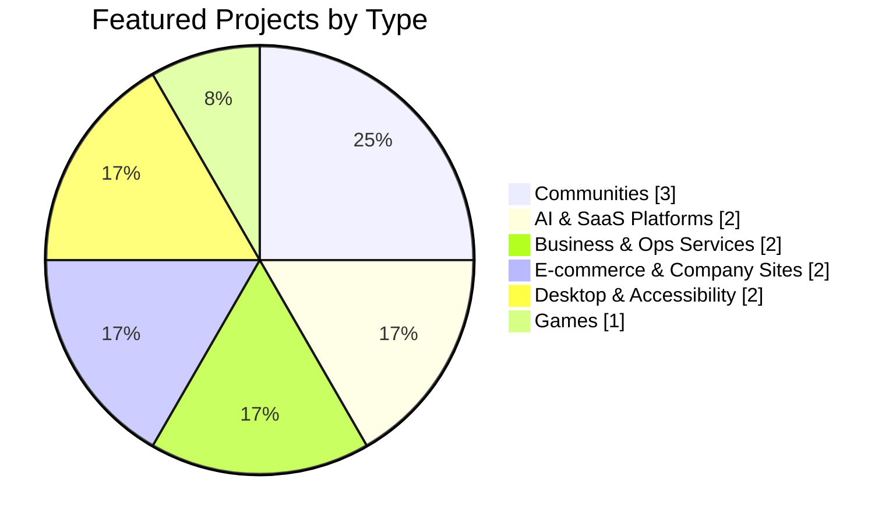
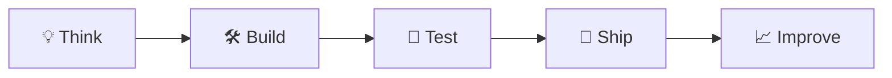

<h1 align="center">Hi, I'm Ramgopal 👋</h1>
<h3 align="center">Full-Stack Developer · Product Builder · India 🇮🇳</h3>

  I turn ideas into clean, scalable products that people actually use. 
  From first sketch to shipped release.

  
  
  
  

---

### 🧑‍💻 About Me

- 🚀 **3+ years** building and shipping products end to end
- 📦 **50+ projects** delivered across web, mobile and cloud
- 🌍 **10K+ users** reached through my products and client work
- 🎯 Currently building **Loupi** and **MySaathi**
- 💬 Ask me about **Next.js, React, Node.js, Python**

---

### 🛠️ Tech Stack

**Frontend** 

**Backend** 

**Database** 

**Cloud & DevOps** 

**Tools** 

---

### 📊 What I Build

---

### 🚀 Featured Projects

| Project | What it does | Stack |
|:--|:--|:--|
| 🎙️ **[StudTalk](https://www.studtalk.com.au/)** | Community + podcast for international students | Next.js · React · Tailwind |
| ⚙️ **[TheOpsGuild](https://theopsguild.com/)** | Ops partner running pipelines for founders | Next.js · Node.js · Tailwind |
| 🤖 **[Mivvo](https://mivvo.life/)** | AI mock interviews, practice and feedback | Next.js · Python · Tailwind |
| 🏙️ **[Kynectia](https://kynectia.com/)** | City community to find co-founders and collaborators | Next.js · React · Tailwind |
| 💼 **[ManagePro](https://managepro.cloud/)** | AI HRMS + finance: payroll, attendance, GST/TDS | Next.js · Python · Tailwind |
| 💥 **[Web Rampage](https://webrampage.space/)** | Type any website and smash it to pieces | Next.js · React · Tailwind |

**🔜 Coming soon:** **Loupi** (desktop voice buddy · Tauri + Rust) and **MySaathi** (Indian Sign Language with a 3D avatar · Next.js + Three.js)

👉 [See all projects on my portfolio](https://www.ramgopal.space/#projects)

---

### 💼 Experience

| Role | Company | Period |
|:--|:--|:--|
| Full-Stack Developer | Freelance · Own SaaS Products | 2023 – Present |
| Software Development Intern | Cloudscore | Nov 2025 – Apr 2026 |
| Full Stack Engineer | Mockopedia | Jun 2025 – Oct 2025 |
| Full-Stack Developer Intern | X-TechStacks · Remote | Aug 2023 – May 2025 |

---

### 🔁 How I Build

---

  <b>Have an idea? Let's build something real. 🚀</b>  
  

