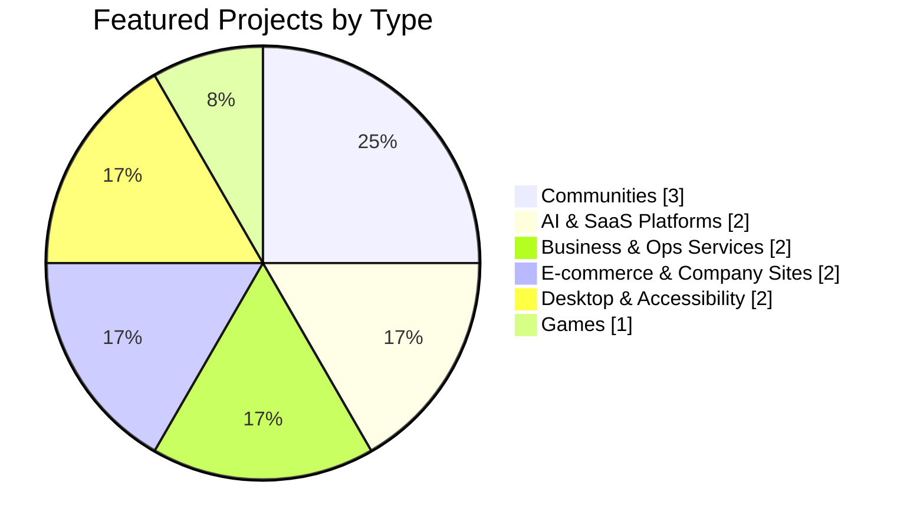
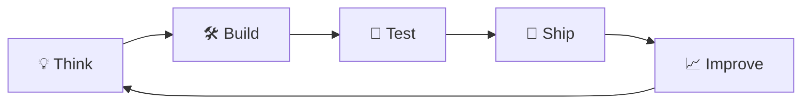

<!-- ===================== HEADER ===================== -->
<p align="center">
  
</p>

<p align="center">
  <a href="https://www.ramgopal.space">
    
  </a>
</p>

<p align="center">
  <a href="https://www.ramgopal.space"></a>
  <a href="https://www.linkedin.com/in/ramgopal-bagh/"></a>
  <a href="mailto:ramgopalbagh009@gmail.com"></a>
  <a href="https://wa.me/918280993756"></a>
</p>

<p align="center">
  
  
  
</p>

---

## 🧑‍💻 About Me

<table>
<tr>
<td width="55%">

```ts
const ramgopal = {
  role: "Full-Stack Developer & Product Builder",
  location: "India 🇮🇳",
  builds: ["SaaS", "Web apps", "AI tools", "Communities"],
  currently: "Shipping own products + freelancing",
  focus: "Clean code. Real problems. Real users.",
  fuel: "☕ ∞",
};
```

</td>
<td width="45%">

- 🚀 **3+ years** shipping products end to end
- 📦 **50+ projects** across web, mobile & cloud
- 🌍 **10K+ users** reached, **20+ countries**
- ⭐ **4.9/5** average client rating
- 🎯 Building **Loupi** & **MySaathi**
- 💬 Ask me about **Next.js, Node, Python**

</td>
</tr>
</table>

---

## 🏅 By the Numbers

<p align="center">
  
  
  
  
  
  
</p>

---

## 🛠️ Tech Stack

<p align="center"><b>Frontend</b></p>
<p align="center"></p>

<p align="center"><b>Backend</b></p>
<p align="center"></p>

<p align="center"><b>Database</b></p>
<p align="center"></p>

<p align="center"><b>Cloud & DevOps</b></p>
<p align="center"></p>

<p align="center"><b>Tools</b></p>
<p align="center"></p>

---

## 📊 GitHub Analytics

<p align="center">
  
</p>

<p align="center">
  
  
</p>

<p align="center">
  
  
</p>

<p align="center">
  
</p>

---

## 📈 Contribution Activity

<p align="center">
  
</p>

<p align="center">
  
</p>

---

## 🥧 What I Build



---

## 🚀 Featured Projects

| Project | What it does | Stack |
|:--|:--|:--|
| 🎙️ **[StudTalk](https://www.studtalk.com.au/)** | Community + podcast where international students share real stories and advice | Next.js · React · Tailwind |
| ⚙️ **[TheOpsGuild](https://theopsguild.com/)** | Ops partner running marketing, sales, support & hiring pipelines for founders | Next.js · Node.js · Tailwind |
| 🤖 **[Mivvo](https://mivvo.life/)** | AI platform for mock interviews, coding/aptitude practice, and feedback | Next.js · Python · Tailwind |
| 🏙️ **[Kynectia](https://kynectia.com/)** | City community to find co-founders, clients, and collaborators nearby | Next.js · React · Tailwind |
| 💼 **[ManagePro](https://managepro.cloud/)** | Private AI HRMS + finance: payroll, attendance, bookkeeping, GST/TDS | Next.js · Python · Tailwind |
| 💥 **[Web Rampage](https://webrampage.space/)** | Type any website and smash it to pieces. The live page becomes the level | Next.js · React · Tailwind |
| 🏛️ **[The Guild Hall](https://www.theguildhall.io/)** | Ops community for lean teams: playbooks, Q&A, ideas board | Next.js · React · Tailwind |
| 📸 **[Moment House](https://momenthouse.space/)** | Social media service for small businesses with monthly content | Next.js · React · Tailwind |

### 🔜 Coming Soon

| Project | What it does | Stack |
|:--|:--|:--|
| 🗣️ **Loupi** | A quiet voice buddy in your system tray. Hit a hotkey, speak, it answers out loud | Tauri · Rust · React |
| 🤟 **MySaathi** | Speech & video → Indian Sign Language with a 3D signing avatar for Deaf & hard-of-hearing people | Next.js · Three.js · React |

<p align="center"><a href="https://www.ramgopal.space/#projects"><b>→ See all projects on my portfolio</b></a></p>

---

## 💼 Experience

| Role | Company | Period |
|:--|:--|:--|
| **Full-Stack Developer** | Freelance · Own SaaS Products | 2023 – Present |
| **Software Development Intern** | Cloudscore | Nov 2025 – Apr 2026 |
| **Full Stack Engineer** | Mockopedia (CAT prep platform) | Jun 2025 – Oct 2025 |
| **Full-Stack Developer Intern** | X-TechStacks · Remote | Aug 2023 – May 2025 |

---

## 🔁 How I Build



> *"Progress isn't luck. It's consistent work, curiosity and a desire to build things that matter."*

---

<p align="center">
  <b>Have an idea? Let's build something real. 🚀</b><br/><br/>
  <a href="mailto:ramgopalbagh009@gmail.com"></a>
</p>


